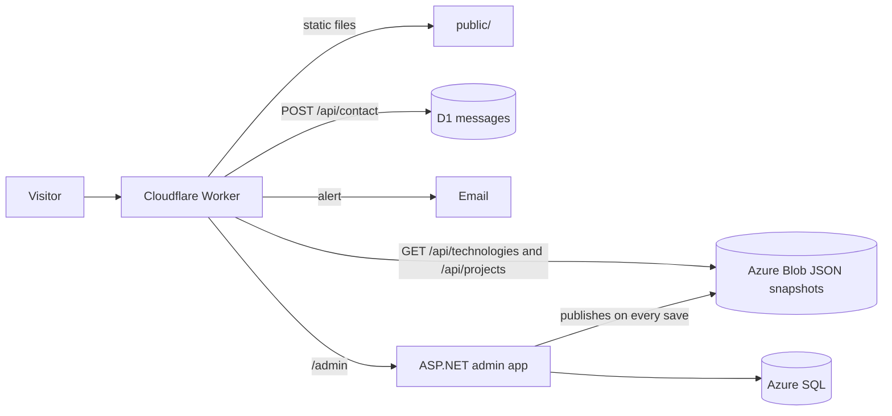

# Portfolio-Website

The source for **[glursolutions.com](https://glursolutions.com)**, my portfolio site: a dark, hand-written HTML/CSS/JS front end served by a Cloudflare Worker, with project content edited in a separate ASP.NET admin app and a spam-filtered contact form.

There is no framework and no build step. The `public/` folder is the site, and the Worker in `src/` is the only server code.

## What it does

- **Landing page** with a hero and typed code windows, skill pills that filter the project cards, a contact form, an About section and an animated lava-lamp background drawn on `<canvas>`.
- **One shared project page** (`projects.html?project=<slug>`) that shows whichever project the address names. Each project has a design-process slideshow, an improvements slideshow, feedback and "what improved" notes, a details panel (role, tools, timeframe) and two optional buttons: **Go to live site** and **See the design notes**.
- **Slideshows** that advance every 5 seconds with a countdown bar and pause button, plus arrows, stage buttons, arrow/Home/End keys, swipe, and an enlarged (lightbox) view.
- **Contact form** that validates on the server, filters spam, saves every message to Cloudflare D1 and emails an alert.
- **Content from a database** without a live API: pages read JSON snapshots written by the admin app, so visitors never touch the database.
- **Accessible and responsive**: skip link, labelled landmarks, visible focus, `prefers-reduced-motion` handled in CSS and JS, and layouts that change at 1440px, 900px and 600px.

## How it fits together



| Request | Handled by | Goes to |
| --- | --- | --- |
| `/admin`, `/admin/*` (any capitalisation) | `src/adminProxy.js` | The ASP.NET admin app on Azure |
| `POST /api/contact` | `handleContact` in `src/worker.js` | D1 database, then an email alert |
| `GET /api/technologies`, `/api/projects`, `/api/projects/<slug>` | `handleContent` in `src/worker.js` | The saved JSON in Azure Blob storage, cached at the edge |
| Any other `/api/*` | Worker | `404` |
| Everything else | Static assets | Files in `public/` |

`wrangler.toml` lists `/api/*` and the admin paths in `run_worker_first`, so only those requests wake the Worker. Everything else is served straight from `public/`.

The admin app lives in its own repository: [GlurSolutions-DB-ASP.NET-Web-App](https://github.com/GLUR-DEV/GlurSolutions-DB-ASP.NET-Web-App). It writes `technologies.json`, `projects.json` and one `project-<slug>.json` per published project to Blob storage on every save.

## Repository layout

```
public/                  The website (the only public folder)
  index.html             Landing page
  projects.html          Shared project page (placeholder projects as a fallback)
  content.js             Fetches content from /api and builds the cards, pills and project page
  indexscript.js         Header, code typing, card reveal, nav highlight, skill filter, contact form, lava lamp
  projectsscript.js      Project picker, slideshows, enlarged-picture view
  indexstyles.css        Design tokens and shared styles
  projectsstyles.css     Project page styles
src/
  worker.js              /api/contact, content proxy and request routing
  filters.js             Email validation, DNS check and spam scoring
  email.js               Alert email
  adminProxy.js          Forwards /admin to the ASP.NET app
migrations/              D1 (SQLite) migrations for the messages table
wrangler.toml            Worker, assets, D1, email and variable configuration
```

## Front end

- **Load order.** Both pages load only `content.js` (with a `data-then` list). It fetches the content, rebuilds the pills, cards or project section, and only then loads `indexscript.js` and `projectsscript.js`, so filters, slideshows and animations attach to the real content.
- **Safe fallback.** If `/api` is slow (4 second timeout), down or not configured, the placeholder HTML already in the page is left as it is and the other scripts still load, so the site is never blank.
- **No injected markup.** Database text is added with `textContent` and `setAttribute`, never as HTML. Image addresses must be `https://` or a plain path on the site, and the two project button addresses must be `https://`.
- **Project addresses.** `projects.html?project=<slug>` shows one project. Old links such as `?project=one` map to `project-one`, and an unknown name shows "Project not found".
- **Design.** Bricolage Grotesque for text and JetBrains Mono for labels and code. Tokens (colours, type, radii) are CSS variables at the top of `indexstyles.css`; the design uses one green accent and a sparing terracotta.

## Contact form

The form posts JSON to `/api/contact`. Without JavaScript it falls back to a `mailto:` link. The Worker runs these checks in order:

1. **Honeypot.** A filled hidden field gets a normal "ok" reply and nothing is saved.
2. **Basics.** Name and message are required (name up to 100 characters, message 10 to 5000).
3. **Email.** Format check, then throwaway-inbox and placeholder domains are rejected, then Cloudflare DNS-over-HTTPS (2 second timeout) confirms the domain exists and can take mail. A failed lookup never blocks a real visitor.
4. **Rate limit and duplicates.** At most 5 messages per hour per hashed IP, and an identical email and message within 24 hours is ignored. Only a salted one-way hash of the IP is stored, never the address itself.
5. **Scoring** (`src/filters.js`) adds points for links, spam and cold-outreach wording, odd text, odd names, missing mail servers and a form filled in too quickly.

| Score | Status | What happens |
| --- | --- | --- |
| 0 to 2 | `ok` | Saved, alert emailed |
| 3 to 5 | `review` | Saved, alert emailed with a `[Check]` subject and the reasons |
| 6 or more | `spam` | Saved quietly, no alert |

Nothing is ever thrown away, so false positives can be reviewed, and spammers get the same friendly reply as everyone else. Alerts are sent with Cloudflare's `send_email` binding, with the visitor set as `Reply-To`.

## Admin area

`/admin` is forwarded by `src/adminProxy.js` to the ASP.NET app. The proxy:

- sends a secret header (`X-Origin-Secret`) that the app requires, so the plain `azurewebsites.net` address shows nothing;
- passes the real visitor IP in `X-Client-Ip` and always overwrites any value the browser sent;
- redirects other capitalisations to lower-case `/admin` and rewrites redirects from the Azure address to the public site;
- sets `Cache-Control: no-store` and removes `Server` and `X-Powered-By`.

Cloudflare Access sits in front of `/admin` as a first sign-in layer, and the app has its own login. Access is configured in Cloudflare, not in this repository.

## Running it locally

You need Node.js and a Cloudflare account. Wrangler is run with `npx`, so there is no `package.json` or install step.

```bash
# Create the local D1 tables
npx wrangler d1 migrations apply glur-db --local

# Start the Worker and static site
npx wrangler dev
```

Content is read from the `SNAPSHOT_BASE` address in `wrangler.toml`, so the local site shows the published projects. To test `/admin`, add `ADMIN_ORIGIN_SECRET` to a `.dev.vars` file (it is git-ignored). If `EMAIL` or the alert addresses are not configured, the alert is skipped and the message is still saved.

## Configuration

Values live in `wrangler.toml`. Secrets are never committed.

| Name | Kind | Purpose |
| --- | --- | --- |
| `ASSETS` | Assets binding | Serves the `public/` folder |
| `DB` | D1 binding (`glur-db`) | Contact messages |
| `EMAIL` | Email binding | Sends alerts to one fixed address |
| `ALERT_TO`, `ALERT_FROM` | Variables | Alert addresses (the sender must be on a Cloudflare-verified domain) |
| `SNAPSHOT_BASE` | Variable | Blob container holding the JSON snapshots (needs public read, or the Worker must send a key) |
| `API_ORIGIN` | Variable | Admin app address, used only to forward `/admin` |
| `ADMIN_ORIGIN_SECRET` | Secret | Must match the admin app's `Admin__OriginSecret`. Set with `npx wrangler secret put ADMIN_ORIGIN_SECRET` |
| `IP_SALT` | Secret (optional) | Salt for the hashed IP used by the rate limit |

## Database migrations

`migrations/` holds the D1 migrations for the `messages` table:

- `0001_create_messages.sql` creates the table.
- `0002_message_filtering.sql` adds `status`, `score`, `reasons`, `ip_hash` and `alerted`, plus an index for the rate limit.

Apply them to the live database with `npx wrangler d1 migrations apply glur-db --remote`.

## Deploying

Deploy the Worker and `public/` together with `npx wrangler deploy`. The Worker `name` in `wrangler.toml` must match the Worker in the Cloudflare dashboard.

After changing anything in `wrangler.toml`, redeploy so the new bindings and variables take effect. Content edits do not need a deploy: they go through the admin app and appear within about two minutes, once the edge and browser caches (60 seconds each) expire.

## Content and caching

The Worker serves each snapshot from Cloudflare's edge cache for 60 seconds, then re-reads it from Blob storage (8 second timeout). If storage is unreachable, the last good copy, up to 24 hours old, is served instead. A missing file returns `404`, and a storage failure returns a short reason code (`storage-status-<code>`, `timeout` or `network`), never an internal message.
